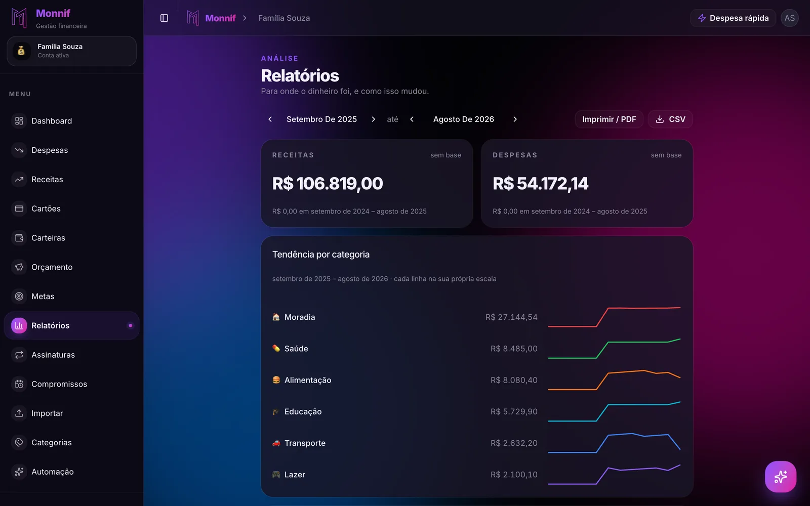

Todo **app de controle financeiro grátis** tem alguém pagando o servidor. A pergunta não é se
existe um modelo de negócio — existe sempre —, é qual, porque é ele que decide o que o app faz
com os seus dados e em que momento o grátis para de servir.

São quatro respostas possíveis, e dá para descobrir qual é a do app que você está olhando em
dez minutos, antes de lançar o primeiro gasto.

## Os quatro jeitos de um app grátis se pagar

### Anúncio

O sinal é visível: banner, vídeo, "oferta especial para você". Em app de finanças, o anunciante
mais comum é crédito — empréstimo, cartão novo, antecipação. E o app sabe exatamente quando
você está apertado, que é quando a oferta converte melhor.

O incentivo também muda o produto. Um app pago por anúncio precisa que você passe mais tempo
dentro dele. Um app de controle financeiro bom faz o contrário: responde rápido e deixa você
fechar.

### Dado

Sem anúncio e sem assinatura, o dinheiro está vindo de algum lugar. A política de privacidade
conta onde: procure "parceiros", "fins de marketing" e "dados anonimizados" perto da palavra
"compartilhar". Seu histórico de gastos diz quanto você ganha, onde mora, se tem filho e se
está devendo — é um dos perfis mais valiosos que existem.

### Teste disfarçado de grátis

Sete ou catorze dias, e o cartão de crédito pedido no cadastro "só para confirmar". Isso não é
plano grátis, é vitrine com cobrança automática no fim. O teste é simples: se o cadastro pede
cartão, não é grátis.

### Grátis com limite

É o modelo honesto, desde que o limite esteja no lugar certo. O grátis cobre o essencial e o
pago cobra pelo conforto e pelo volume: mais cartões, mais pessoas, histórico mais longo,
leitura automática.

O limite no lugar errado é o que trava **o hábito**: teto de lançamentos por mês, por exemplo.
No dia 20 o app para de aceitar gasto, você para de anotar, e o controle morre exatamente no
fim do mês — que é quando ele mais importa.

| Modelo | Como reconhecer | O que pode dar errado |
|---|---|---|
| Anúncio | Banner e oferta de crédito dentro do app | Empréstimo oferecido no seu pior mês |
| Dado | Sem anúncio, sem plano pago, política vaga | Seu perfil financeiro vendido |
| Teste | Prazo em dias, cartão no cadastro | Cobrança no dia 15 |
| Grátis com limite | Tabela de planos clara | Limite no hábito em vez do conforto |

## O mínimo que o grátis precisa ter

Um plano grátis serve para controlar o dinheiro de verdade quando tem estas seis coisas. Sem
alguma delas, ele serve para experimentar — e você vai descobrir isso no segundo mês.

1. **Cartão de crédito com fatura.** A compra cai na fatura certa e o parcelado aparece mês a
   mês. No Brasil, é no cartão que o controle quebra — o porquê está em
   [sua fatura não segue o mês do calendário](/blog/ciclo-da-fatura/).
2. **Contas fixas e o que ainda vai vencer.** Um app que só soma o que já saiu é retrovisor.
3. **Conta compartilhada sem dividir senha**, se a casa não é de uma pessoa só.
4. **Um jeito rápido de lançar**, de preferência sem abrir o app. É o que mantém o hábito vivo.
5. **Exportação dos dados.** O histórico é seu, e precisa poder ir embora com você.
6. **Nenhuma senha de banco.** Quem quer evitar digitação importa o extrato baixado no site do
   próprio banco, como em [três meses de histórico em cinco minutos](/blog/importar-extrato-sem-digitar/).

O que pode ser pago sem prejuízo: leitura de cupom por foto, categoria automática, histórico
de muitos meses nos relatórios, mais carteiras e cartões, mais gente na conta. Tudo isso
deixa o controle mais confortável. Nada disso é o controle.

## Grátis para casal e pelo WhatsApp

As duas coisas que mais costumam ficar atrás da assinatura são justamente as que mais fazem o
controle sobreviver: **a conta compartilhada** e **o lançamento pelo WhatsApp**.

Para casal, as perguntas são três: o grátis vale para os dois? Existe cobrança por pessoa?
Cada um tem o próprio login? O que vem depois — a divisão das contas da casa — está em
[dividir as contas do casal](/blog/dividir-contas-do-casal/).

Para o WhatsApp, a pergunta é se ele está no grátis e qual é a cota de mensagens. E, antes de
vincular o número, as perguntas de segurança de
[controle financeiro pelo WhatsApp](/blog/controle-financeiro-pelo-whatsapp/).

## Quando vale pagar

Um app de R$ 20 por mês custa R$ 240 por ano. Ele se paga se, num ano, fizer você achar uma
assinatura esquecida de R$ 39,90 — que custa R$ 478,80 por ano — ou fugir uma vez do rotativo
do cartão. O primeiro caso é mais comum do que parece, e está em
[as assinaturas que você não lembra que assinou](/blog/assinaturas-esquecidas/).

A regra que funciona: **comece no grátis e pague quando o limite atrapalhar o hábito**, não
quando o recurso parecer interessante na tabela. Se você está esbarrando no limite toda semana,
pagar faz sentido. Se nunca esbarrou, o grátis está fazendo o trabalho.

A lista completa do que olhar num app, pago ou não, está em
[app de gestão financeira: as sete perguntas que eliminam quase todos](/blog/app-de-gestao-financeira/).

## Como isso fica no Monnif

**O grátis não expira e não pede cartão.** Não é teste de 7 dias nem período promocional, e
não tem anúncio. Os seus dados financeiros não são vendidos, e as conversas com o assistente
não treinam modelo nenhum — o detalhe está em [segurança](/seguranca/) e na
[política de privacidade](/privacidade/).

**O que vem nele cobre as seis coisas da lista.** O
[assistente no WhatsApp](/docs/assistente/whatsapp/), por mensagem ou áudio. Duas contas, com até duas [pessoas](/docs/conta/usuarios/) em cada.
Duas carteiras e dois [cartões com fatura](/docs/dia-a-dia/cartoes/). Contas fixas, compras
parceladas e lembrete de conta vencendo. [Relatórios](/docs/planejamento/relatorios/) com
exportação em CSV e PDF. E nenhuma conexão com banco: o histórico entra
[importando o extrato](/docs/dados/importar/).

**O pago é conforto e volume.** O Plus traz leitura de cupom por foto, categoria automática,
seis meses de histórico nos relatórios e limites maiores. O Super tira os limites de contas,
cartões e pessoas e traz a divisão de despesa entre as pessoas da conta. Valores e a lista
completa estão em [preços](/precos/).

**Parar de pagar não apaga nada.** A conta volta para o grátis com os lançamentos, as carteiras
e o histórico inteiros. O que muda é quanta coisa nova dá para criar.

## Dez minutos antes de baixar

Abra a página de preços e a política de privacidade do app que você usa hoje — ou do que está
pensando em baixar — e responda três perguntas:

1. O cadastro pede cartão de crédito?
2. O grátis tem prazo para acabar?
3. A palavra "parceiros" aparece perto da palavra "dados"?

Três "não" e você achou um grátis de verdade. Qualquer "sim" e você já sabe quem está pagando
a conta.
