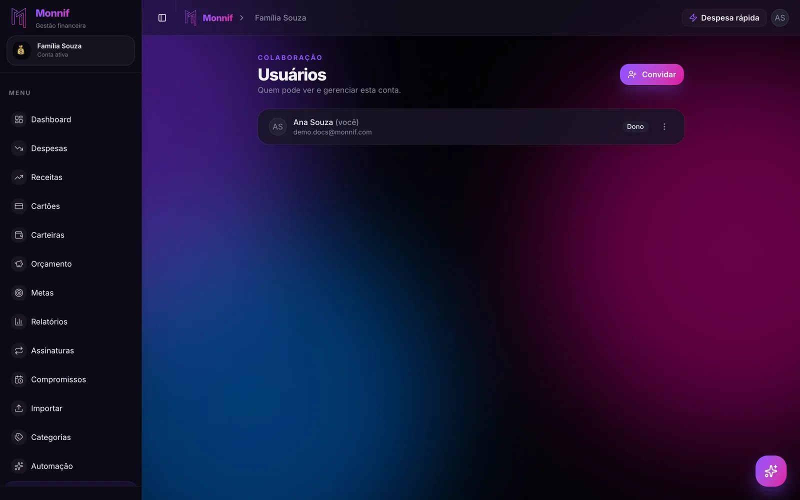
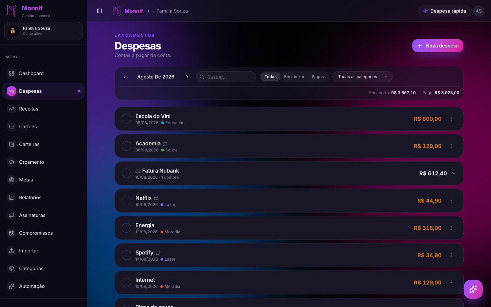
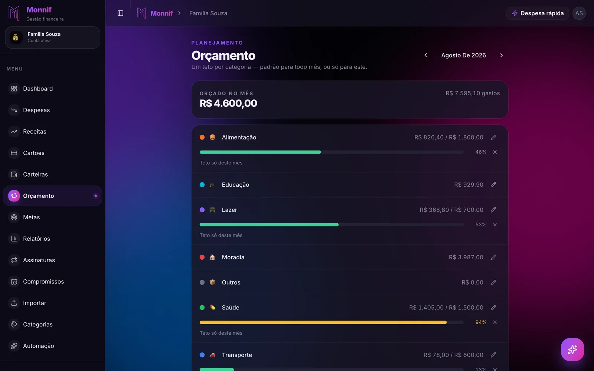

Procurar o **melhor app de finanças para casal** devolve listas de dez nomes ordenadas pela
nota na loja. A nota mede quem baixou e gostou da tela. Não mede o que decide um casal: se a
pessoa que não liga para planilha ainda está anotando no terceiro mês.

Quase todo casal tem uma pessoa que cuida e outra que acompanha de longe. O app certo não é o
que agrada a primeira — essa usaria até um caderno. É o que a segunda usa sem perceber que
está usando. E, de preferência, sem que os dois paguem por isso.

## O buraco tem o tamanho dos gastos pequenos

Júlia e Rafael gastam R$ 6.000 por mês com a casa. Júlia cuida do app e lança tudo o que
paga. Rafael lança as contas fixas, que chegam por boleto e são fáceis de lembrar. Os gastos
pequenos — o mercado de reposição, o delivery, o estacionamento — ele deixa para depois.

| | Pagou | Anotou | Ficou de fora |
|---|---|---|---|
| Júlia | R$ 3.400 | R$ 3.400 | — |
| Rafael, contas fixas | R$ 1.400 | R$ 1.400 | — |
| Rafael, 32 gastos pequenos | R$ 1.200 | R$ 400 | R$ 800 |
| **Casa** | **R$ 6.000** | **R$ 5.200** | **R$ 800** |

R$ 800 é 13% do mês. Parece pouco até você ver onde eles estão: todos em mercado, delivery e
transporte, que são exatamente as categorias que o orçamento existe para controlar. O teto de
alimentação diz que sobrou dinheiro; a conta do banco diz que não. No ano, são R$ 9.600 que o
app nunca viu.

E a conversa que vem depois começa errada. Não é sobre dinheiro, é sobre quem anotou. Por que
esse desgaste aparece em quase todo casal que usa um app feito para uma pessoa só está em
[gestão financeira para casais](/blog/gestao-financeira-para-casais/).

Rafael não é desleixado. Ele só não abre um app para anotar R$ 37 na fila da padaria — quase
ninguém abre. Por que mudar o lugar de anotar resolve mais do que cobrar disciplina está em
[anotar gasto pelo WhatsApp](/blog/anotar-gasto-pelo-whatsapp/).

## "Grátis" a dois tem três letras miúdas

Um app grátis para uma pessoa pode não ser grátis para um casal. Antes de instalar, leiam a
página de preços procurando três coisas.

**A segunda pessoa paga?** É a cobrança mais comum: o grátis tem um login, e a conta
compartilhada é do plano pago. O casal acaba dividindo a senha para não pagar — e perde o
registro de quem lançou o quê, que é justamente o que evita a conversa errada.

**O WhatsApp é de cada um?** Um bot que aceita um número por conta resolve a pessoa que já
anotava e deixa de fora a que não anotava. Para o casal, o número que importa é o segundo.

**O grátis expira?** Teste de 7 dias não é plano grátis. O hábito que interessa — os dois
anotando — só aparece depois do primeiro mês, e aí a cobrança já começou. Os quatro jeitos de
um app grátis se pagar estão em
[app de controle financeiro grátis](/blog/app-de-controle-financeiro-gratis/).

## Por que o WhatsApp decide

A pessoa que acompanha de longe abre o WhatsApp umas quarenta vezes por dia. O app de
finanças, nenhuma. Pedir que ela crie o hábito de abrir mais um app é pedir que ela mude;
pedir que ela mande uma mensagem a mais é pedir quase nada.

Com um número vinculado para cada um, o lançamento sai do aparelho de quem gastou, na hora em
que gastou, com o nome de quem mandou. Ninguém repassa comprovante, ninguém tenta lembrar no
domingo o valor da terça. O que checar num bot antes de dar o seu número a ele está em
[controle financeiro pelo WhatsApp](/blog/controle-financeiro-pelo-whatsapp/).

## 1. Dia zero: dez minutos, os dois juntos

Façam a configuração no mesmo sofá, cada um com o próprio celular. Feita separada, um dos dois
termina e o outro "faz depois".

- Quem cria a conta convida o outro por link. Cada um entra com o próprio e-mail e a própria
  senha.
- Cada um vincula o próprio número de WhatsApp, apontando para a conta da casa.
- Definam teto para três categorias só: mercado, delivery e transporte. São as do buraco da
  tabela. As outras esperam o mês que vem.
- Combinem uma regra antes do primeiro gasto: **quem pagou, lança.**

## 2. Dias 1 a 6: quem pagou, lança

A regra parece burocrática e resolve dois problemas. O primeiro é o duplicado: os dois foram ao
mercado, os dois mandaram "mercado 312", e a semana ganhou R$ 312 que não saíram de lugar
nenhum. O segundo é o acerto: se quem pagou é quem lança, cada linha já diz de quem saiu o
dinheiro — que é metade da conta de [dividir as contas do casal](/blog/dividir-contas-do-casal/).

As mensagens são as de qualquer conversa:

> mercado 312 no cartão

> uber 23

> gasolina, cento e oitenta, no débito

A última vale mandar por áudio, saindo do posto. E, na frente da prateleira, a pergunta que o
teto existe para responder:

> quanto ainda dá pra gastar com mercado esse mês?

O gasto pessoal fica fora da conta da casa. O que é só seu vai para a sua conta pessoal, no
app — ou para lugar nenhum, se o combinado de vocês é um valor por pessoa que não precisa de
justificativa. Esse combinado, e os três arranjos que costumam funcionar, estão em
[dinheiro a dois](/blog/dinheiro-a-dois/).

## 3. Dia 7: quinze minutos no domingo

Abram o histórico juntos. A primeira semana de Júlia e Rafael ficou assim:

| | Lançamentos | Valor |
|---|---|---|
| Júlia | 9 | R$ 498 |
| Rafael | 8 | R$ 593 |
| **Total no app** | **17** | **R$ 1.091** |

No sábado, os dois mandaram o mesmo mercado de R$ 312. A semana de verdade foi de R$ 779.

O erro da primeira semana costuma ser o contrário do que se teme: não falta gasto, sobra. É
bom sinal — quer dizer que os dois estão mandando. Conferindo três coisas, o domingo acaba:

**Os dois aparecem?** Se um nome aparece 15 vezes e o outro 2, o buraco da primeira tabela
voltou — e dá para ver isso sem ninguém acusar ninguém.

**Tem duplicado?** Mesmo valor, mesmo dia, dois autores. Apaguem um e relembrem a regra.

**A compra no crédito caiu no cartão?** O mercado de sábado no cartão só sai do banco quando
a fatura vencer. Lançado como débito, ele faz a conta corrente parecer R$ 312 mais curta do que
está. A mecânica está em [sua fatura não segue o mês do calendário](/blog/ciclo-da-fatura/).

## Como isso fica no Monnif

**Grátis para os dois, cada um com o próprio login.** A conta da casa recebe as duas pessoas
sem pagar nada e sem cartão no cadastro. O convite é por link, e o papel de cada um — Dono,
Admin ou Membro — está em [pessoas e papéis](/docs/conta/usuarios/). A comparação com
planilha e outros apps, pelos critérios de casal, está em
[controle financeiro para casal: qual usar](/comparar/casal/).

**Um WhatsApp para cada um.** Cada pessoa [vincula o próprio número](/docs/assistente/whatsapp/)
em Preferências → Assistente e escolhe em que conta ele lança. Texto e áudio são grátis, com
uma cota mensal de mensagens por pessoa — um não gasta a do outro. O lançamento aparece para
o outro na hora; a conversa, não. Ela é de quem mandou e não treina modelo nenhum, como está
em [limites e privacidade](/docs/assistente/limites/).

**O domingo cabe no histórico.** O [histórico](/docs/dados/historico/) mostra cada lançamento
com quem fez e quando, inclusive o que entrou pelo WhatsApp. É ali que o "mercado 312" mandado
duas vezes aparece com dois nomes.

**O duplicado sai no app, não por mensagem.** Excluir lançamento é uma das três coisas que não
acontecem pelo WhatsApp: um celular perdido não pode apagar o histórico de vocês. Na tela de
[despesas](/docs/dia-a-dia/despesas/), o menu de três pontos da linha resolve.

**O teto responde na fila do caixa.** "Quanto ainda dá pra gastar com mercado?" sai do
[orçamento](/docs/planejamento/orcamento/) que vocês definiram no dia zero, e os dois veem a
mesma barra.

**O que é extra, e opcional:** rachar um lançamento entre as pessoas da conta e ver quem deve
quanto a quem, e ler a foto do cupom. Conta compartilhada, WhatsApp dos dois, orçamento,
cartão e relatórios são grátis. O resumo para quem divide a casa está em
[Monnif para casais](/para/casal/).

## A conta antes de escolher

Hoje à noite, cada um abre o extrato do mês passado e conta os gastos abaixo de R$ 50: quantos
foram e quanto somaram. Não precisa categorizar nada, só contar.

Se a soma dos dois passar de R$ 500, vocês já sabem qual é o melhor app de finanças para o
casal de vocês: o que anota esses gastos na fila do caixa, do celular de quem pagou. O resto é
tela.
