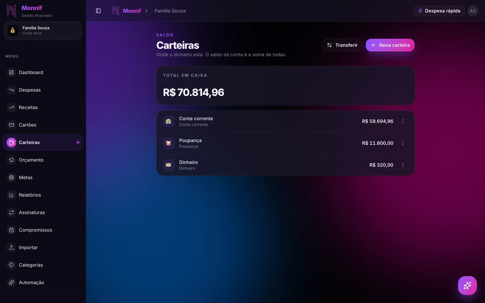

Quase todo mundo que tenta **juntar dinheiro** começa pelo fim do mês: o que sobrar, guarda.
É o método mais popular do país e o que menos funciona — não por falta de força de vontade,
mas porque o gasto do mês se estica até ocupar o dinheiro disponível. No dia 30, o que sobra é
o que ninguém lembrou de gastar, e quase sempre é perto de zero.

O que funciona é o contrário: decidir o valor antes, tirar no começo do mês e deixar num
lugar de onde ele não sai por acidente. São três peças — **um valor, uma data e um lugar** —
e nenhuma delas exige ganhar mais.

## Guardar o que sobra é guardar zero

Pense no mês como uma fila. O aluguel entra primeiro, o mercado depois, as contas, o cartão,
o lanche, o presente de aniversário do colega. Guardar o que sobra é pôr o seu próprio
objetivo no fim dessa fila, depois de todo mundo — inclusive depois de coisas que você nem
queria tanto.

Ninguém faz isso de propósito. Acontece porque o dinheiro parado na conta corrente parece
disponível, e dinheiro disponível é gasto. A conta de onde saem o Pix e o débito é o pior
lugar possível para guardar qualquer coisa.

A correção tem nome antigo — **pague-se primeiro** — e uma mecânica só: no dia em que o
salário cai, uma transferência fixa sai para outra conta. O mês se ajusta ao que ficou, do
mesmo jeito que se ajusta ao aluguel. Você não decide se vai guardar; decide uma vez quanto, e
a transferência faz o resto.

## Primeiro o objetivo, depois o valor

"Juntar dinheiro" sem objetivo dura até a primeira promoção. O dinheiro sem nome não tem
quem o defenda — e a vontade de comprar o tênis tem.

Cada objetivo precisa de duas coisas: quanto e até quando. Com as duas, a meta vira uma conta
de dividir:

| Objetivo | Quanto | Prazo | Por mês |
|---|---|---|---|
| Completar a reserva de emergência | R$ 9.000 | 18 meses | R$ 500 |
| Viagem de julho | R$ 2.700 | 9 meses | R$ 300 |
| Trocar o celular | R$ 3.600 | 12 meses | R$ 300 |
| **Total** | | | **R$ 1.100** |

A última coluna é a que transforma vontade em compromisso. "Quero viajar em julho" não diz
nada ao seu mês. "R$ 300 todo dia 5" diz.

## Quando a soma não cabe, a data anda

Digamos que a pessoa da tabela consiga guardar R$ 800 por mês, e não R$ 1.100. O impulso é
diminuir tudo um pouco. É o pior caminho: três metas andando devagar parecem três metas
paradas, e a primeira a desanimar leva as outras junto.

Melhor escolher a ordem. A reserva vem primeiro — sem ela, o primeiro imprevisto come a
viagem e o celular de uma vez, e o porquê está em
[reserva de emergência: quanto, onde e a partir de quando](/blog/fundo-de-emergencia/).
Depois a viagem, que tem data fixa. O celular espera: começa em agosto, quando a viagem
acabar e os R$ 300 dela ficarem livres.

Mudar a data não é desistir da meta. É a diferença entre uma meta que acontece mais tarde e
uma que não acontece.

Se nem a reserva cabe, o problema não é a meta: é o orçamento, e a conta da
[regra 50/30/20 aplicada ao salário brasileiro](/blog/regra-50-30-20/) mostra em cinco
minutos onde a renda está indo.

## Quanto guardar: o número sai do extrato

O valor por mês não sai da vontade, sai do que de fato sobrou nos últimos meses. Pegue o
extrato dos últimos seis e anote quanto ficou na conta no fim de cada um. O menor desses
números — não a média — é quanto você pode prometer guardar sem que o mês ruim desfaça o
mês bom. Orçamento montado em número imaginado falha no segundo mês, e
[o motivo](/blog/por-que-orcamento-falha/) é sempre o mesmo.

Comece com esse número, mesmo que seja R$ 150. O hábito vale mais que o valor nos primeiros
meses, e ele cresce de dois jeitos que não doem:

- **Metade de todo aumento vai para a meta.** Você sente a outra metade e não sente falta do
  que nunca chegou a gastar.
- **Dinheiro extra tem destino antes de cair.** 13º, restituição, bônus, venda de alguma
  coisa. Sem destino, ele some em dias — o 13º tem até uma ordem própria, em
  [o que fazer com o 13º salário](/blog/o-que-fazer-com-o-13-salario/).

## Um lugar de onde ele não sai por acidente

O dinheiro guardado precisa sair da conta do dia a dia. Pode ser a poupança, uma conta em
outro banco, uma aplicação — o que importa é que ele não apareça no saldo que você olha antes
de pagar o almoço.

Onde exatamente depende da data:

- **Sem data** — a reserva de emergência — precisa de resgate no mesmo dia e não pode perder
  valor. Rendimento é a terceira preocupação, não a primeira.
- **Com data** — a viagem, o celular, a entrada do carro — pode ficar numa aplicação de renda
  fixa que vença perto da data da meta. Prazo conhecido permite ganhar um pouco mais sem risco
  de precisar sacar antes.

E cada meta no seu canto. Juntar tudo num monte só parece mais simples e é o contrário: quando
a viagem chega, ninguém sabe quanto do saldo era dela e quanto era da reserva.
[Gestão de carteiras](/blog/gestao-de-carteiras/) explica por que saber onde o dinheiro está
importa tanto quanto saber quanto ele é.

## Juntar é parcelar ao contrário

Para quem quer comprar alguma coisa, juntar antes é o mesmo parcelamento em 10x, com o sinal
invertido: as mesmas dez parcelas, só que pagas antes da compra. Enquanto isso o dinheiro
rende para você, e no fim você ainda chega com ele na mão para pedir o desconto à vista.

A diferença é só de humor: no parcelamento você tem a coisa e paga depois; juntando, você
paga antes e tem depois. Para o seu mês, a segunda opção é bem mais leve, e o porquê está em
[em 10x sem juros: o mês que vem já está gasto](/blog/em-10x-sem-juros/).

## Como isso fica no Monnif

**Cada objetivo vira uma [meta](/docs/planejamento/metas/)** com valor alvo e, se quiser, uma
data. Com a data, o Monnif calcula quanto guardar por mês para chegar lá — a última coluna da
tabela, refeita sozinha a cada aporte — e a barra mostra o percentual e quanto ainda falta.
Pelo assistente, "cria uma meta de 2.700 para a viagem de julho" já resolve.

**A meta pode acompanhar uma carteira ou receber aportes.** Ligada a uma
[carteira](/docs/dia-a-dia/carteiras/), o progresso é o próprio saldo dela: você transfere e a
barra anda, sem registrar nada a mais. Sem carteira, você registra cada aporte com valor e
data — útil quando várias metas dividem a mesma conta no banco. Nos dois casos, o dinheiro
guardado não entra como despesa e não aparece no gasto do mês.

**O pague-se primeiro vira uma transferência.** A transferência entre carteiras não é despesa
nem receita: ela muda o saldo de cada lado e deixa a sobra do mês intacta. Pelo WhatsApp,
"transfere 300 da conta corrente para a viagem" faz o movimento sem abrir o app. De graça, são
duas carteiras; uma carteira própria para cada meta é um recurso extra, opcional.

**O valor que cabe está na aba Anual.** O [dashboard](/docs/dia-a-dia/dashboard/) põe os
meses do ano lado a lado, com o que sobrou em cada um. O menor desses números é o ponto de
partida honesto para a transferência mensal.

## Os dez minutos de hoje

Escolha **um** objetivo. Só um. Escreva quanto ele custa e a data em que você quer chegar lá.
Divida um pelo outro.

Depois abra o app do banco e agende uma transferência desse valor para o dia seguinte ao
salário, todo mês. Se o número assustou, mude a data — não a decisão. A meta que começa
pequena hoje chega antes da que começa grande "a partir do mês que vem".
