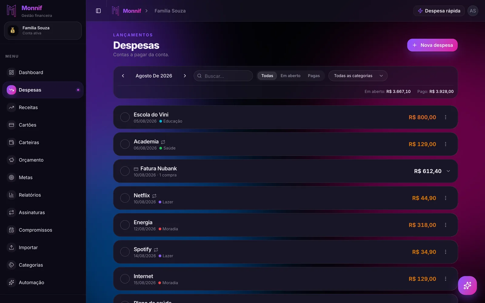
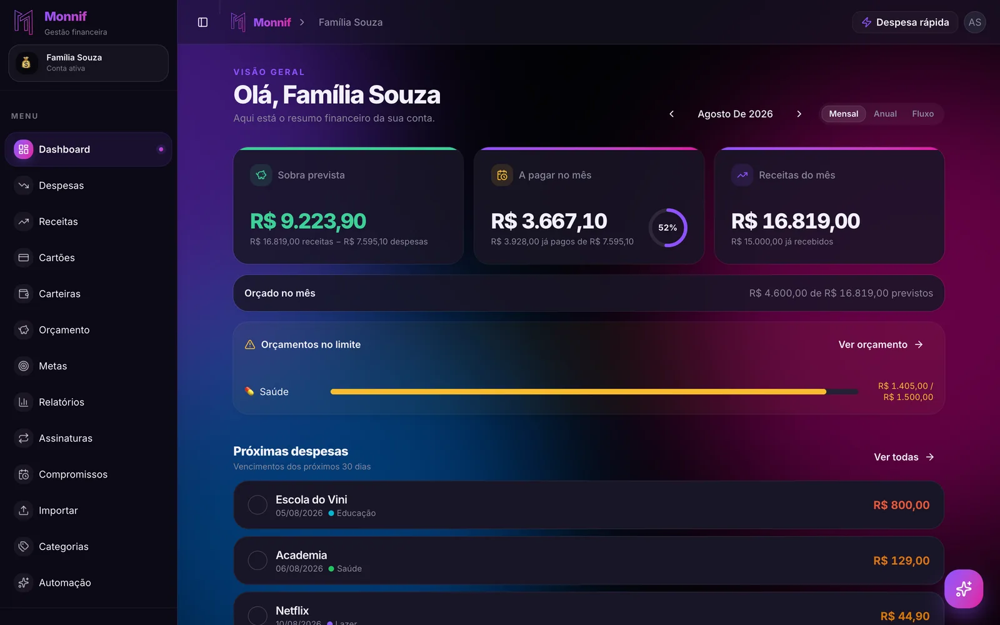

Boa parte das multas por atraso é paga por gente que tinha o dinheiro na conta. A conta de luz
venceu no dia 12, o salário caiu no dia 5, e mesmo assim ela foi paga no dia 19 — porque o
boleto estava no e-mail, o e-mail estava soterrado e ninguém lembrou. Um **controle de contas
a pagar** não existe para achar dinheiro. Existe para que o dinheiro que já está lá saia no
dia certo.

O problema raramente é falta de organização no sentido grande da palavra. É dispersão: cada
conta chega por um canal, vence num dia diferente e sai de um lugar diferente. A solução é
uma lista só, com quatro informações por linha, e um aviso que chegue antes do vencimento —
não no dia.

## Quanto custa esquecer

Conta de consumo e condomínio costumam cobrar multa de 2% e juros de 1% ao mês pelo atraso.
Parece pouco, e para elas é. O cartão de crédito é outra história:

| Conta | Valor | Atraso | Custo do atraso |
|---|---|---|---|
| Luz | R$ 280 | 10 dias | cerca de R$ 6,50 |
| Condomínio | R$ 900 | 10 dias | cerca de R$ 21 |
| Fatura do cartão | R$ 2.500 | 5 dias | cerca de R$ 125 |

A fatura atrasada paga a multa e os juros de mora, como as outras, mas também os juros do
rotativo pelos dias de atraso, mais o IOF. Cinco dias de esquecimento na fatura custam quase
vinte vezes os dez dias da conta de luz. As regras exatas mudam por contrato, e a ordem de
grandeza não.

E o custo não é só esse. A multa da luz vem na conta do mês seguinte, que já chega maior. A
fatura não paga entra no rotativo, e o rotativo é
[a dívida que sai primeiro, sempre](/blog/sair-das-dividas/). Conta atrasada por tempo
demais pode virar corte do serviço ou nome negativado — e aí o custo deixa de ser em reais.

## Por que a gente esquece

Conte por quantos canais as contas da sua casa chegam:

- boleto no e-mail;
- fatura no app do banco;
- condomínio no aplicativo da administradora;
- escola por um portal que só um dos pais acessa;
- Pix da diarista, combinado no WhatsApp;
- débito automático que não avisa nada.

Seis lugares, seis lembretes diferentes, e nenhum deles mostra os outros cinco. Os
vencimentos se espalham pelo mês, e cada um depende de você lembrar de abrir o lugar certo
no dia certo. Esquecer não é descuido: é o resultado esperado de um sistema sem lista.

## A lista tem quatro colunas

O que, quanto, quando vence e de onde sai. Uma casa comum, num mês comum:

| Conta | Vence | Valor | Sai de |
|---|---|---|---|
| Aluguel | dia 5 | R$ 1.800 | Conta corrente |
| Escola | dia 5 | R$ 850 | Conta corrente |
| Fatura do cartão | dia 10 | varia | Conta corrente |
| Condomínio | dia 10 | R$ 650 | Conta corrente |
| Luz | dia 12 | varia | Débito automático |
| Internet | dia 15 | R$ 110 | Cartão de crédito |
| Plano de saúde | dia 20 | R$ 780 | Conta corrente |

A coluna "sai de" parece detalhe e é a que mais evita susto. Conta que sai do cartão não sai
da conta corrente neste mês — ela sai na fatura do mês que vem, e quem soma as duas paga a
mesma coisa duas vezes no papel. O porquê está em
[sua fatura não segue o mês do calendário](/blog/ciclo-da-fatura/). E se a casa tem mais de
uma conta no banco, saber de qual delas cada boleto sai é metade da
[gestão de carteiras](/blog/gestao-de-carteiras/).

As contas que mudam de valor — luz, água, a fatura — entram com uma estimativa e são
corrigidas quando a conta chega. O que importa é a linha existir antes do vencimento.

## Junte os vencimentos

Uma lista com vencimentos nos dias 5, 10, 12, 15 e 20 exige cinco momentos de atenção por
mês. Dá para reduzir a dois.

A maior parte das empresas deixa escolher o dia de vencimento: concessionária de luz e de
água, operadora de internet e celular, plano de saúde, o próprio cartão. Pedir para que tudo
vença nos dias seguintes ao salário custa uma ligação ou dois cliques em cada app, e
transforma "as contas do mês" em uma tarde só.

Quem recebe em duas datas — dia 5 e dia 20, por exemplo — divide as contas em dois blocos,
cada um logo depois de uma das entradas.

## Automatize o pagamento, não a atenção

Débito automático e Pix Automático resolvem o esquecimento, e o DDA — que mostra no app do
banco os boletos emitidos no seu CPF — resolve o boleto que nunca chegou. Use o pagamento
automático para conta de valor previsível: aluguel, escola, plano de saúde, assinatura que
você sabe que quer manter.

Mas saber que vai pagar sozinho não é motivo para tirar a conta da lista. Três coisas que
o débito automático não faz:

- **não avisa quando o valor mudou** — a conta de luz que dobrou é paga do mesmo jeito;
- **não pergunta se o saldo existe** — e débito sem saldo vira cheque especial ou conta não
  paga;
- **não percebe cobrança que você não reconhece** — como a assinatura esquecida que segue
  cobrando, assunto de
  [as assinaturas que você não lembra que assinou](/blog/assinaturas-esquecidas/).

Automático cuida do pagamento. A lista continua cuidando de você.

## As que vencem uma vez por ano

IPVA, IPTU, matrícula, seguro do carro, anuidade de conselho profissional. Elas não estão na
lista do mês, e por isso são as que mais pegam de surpresa — mesmo tendo data marcada há
meses. Entram na lista como conta anual, com o valor do ano passado, e o dinheiro delas vai
sendo separado todo mês. A conta inteira está no passo 4 de
[orçamento familiar](/blog/orcamento-familiar/), e o janeiro em que quase todas vencem tem
um destino natural no [13º salário](/blog/o-que-fazer-com-o-13-salario/).

## Como isso fica no Monnif

**Cada conta é uma despesa com vencimento.** Em [Despesas](/docs/dia-a-dia/despesas/), o
campo de vencimento é a data em que a conta vence, não a data em que você pagou, e a
repetição mensal faz a conta aparecer todo mês sem ser cadastrada de novo. A lista mostra o
mês inteiro, com os totais **Em aberto** e **Pago** no topo; o círculo à esquerda marca como
paga com um clique. Quando a luz chega com outro valor, você edita só aquela, e as futuras
continuam como estavam.

**O aviso chega três dias antes.** O lembrete de
[contas a vencer](/docs/conta/preferencias/) junta as despesas em aberto que vencem nos
próximos três dias e manda por push, e-mail ou WhatsApp — o canal que você escolher, ou os
três. Dois outros avisos completam: **saldo furando**, quando a projeção mostra a conta
ficando negativa na semana, e **cobrança duplicada**, quando a mesma descrição e o mesmo valor
aparecem duas vezes em poucos dias.

**A fatura é uma linha só.** As compras do [cartão](/docs/dia-a-dia/cartoes/) se agrupam na
linha da fatura, com o total do ciclo e o vencimento, e pagar é um clique nela. A conta que
sai do cartão não aparece duas vezes.

**Os próximos 30 dias numa tela.** O [dashboard](/docs/dia-a-dia/dashboard/) lista os
vencimentos dos próximos 30 dias em ordem de data, com o que já venceu e não foi pago em
destaque, e o anel de **A pagar no mês** mostra quanto do total já foi quitado.

**Pagou na rua, marca na rua.** Pelo WhatsApp, "marca a luz como paga" ou "paga a fatura do
Nubank" resolve sem abrir o app. Por que anotar pela mensagem funciona melhor do que
deixar para depois está em [anotar gasto pelo WhatsApp](/blog/anotar-gasto-pelo-whatsapp/).

## A lista desta noite

Abra o e-mail, o app do banco e o aplicativo do condomínio, e escreva cada conta que a casa
paga, com as quatro colunas: o que, quanto, quando vence, de onde sai. Marque as que já estão
no débito automático.

Depois olhe a coluna de vencimentos. Se ela tem mais de três datas diferentes, a primeira
tarefa da semana é ligar para mudar as que dá. A conta que não está na lista é a que vai
atrasar — e a que está, com aviso três dias antes, simplesmente é paga.
