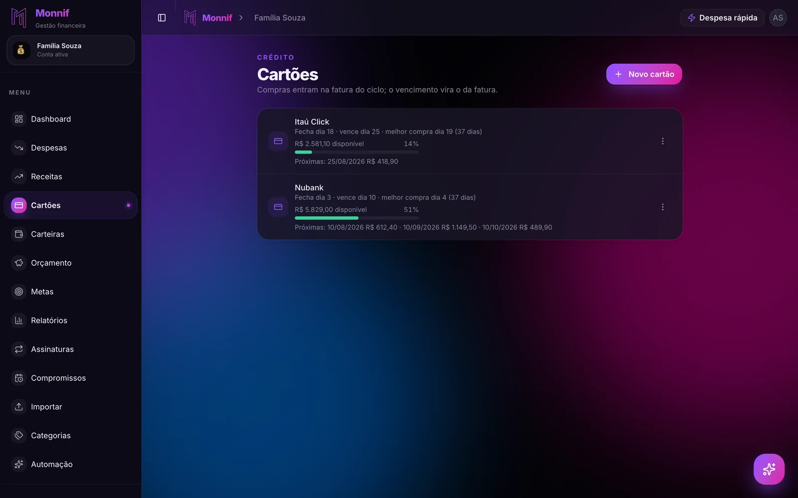

Procurar **controle financeiro pelo WhatsApp** devolve uma fila de bots que, no print, fazem a
mesma coisa: você manda "mercado 120" e alguém responde "anotado". A diferença entre eles não
está na resposta. Está no que acontece com a mensagem depois — onde ela vai parar, quem mais
consegue ler, e o que um celular perdido consegue fazer com a sua conta.

Este texto separa os três tipos de solução que existem e lista o que checar antes de vincular
o seu número a qualquer um deles. Por que anotar pelo WhatsApp funciona quando o app não
funciona já está em [anotar gasto pelo WhatsApp](/blog/anotar-gasto-pelo-whatsapp/). Aqui o
assunto é escolher.

## Os três jeitos de controlar gastos pelo WhatsApp

### A conversa com você mesmo

O WhatsApp deixa você mandar mensagem para o próprio número. Muita gente começa assim:
"uber 23", "farmácia 47", uma linha por gasto. É grátis, é privado e não tem nada para
instalar.

E morre no dia 30, porque ninguém soma. É um caderno, não um controle: não sabe o que é
cartão, não sabe o que é conta fixa e não responde quanto sobrou. Serve como rascunho de uma
semana para descobrir quanto você gasta sem perceber — e só.

### O bot que escreve numa planilha

O bot recebe a mensagem e acrescenta uma linha numa planilha, quase sempre do Google. Resolve
a anotação, que é o gargalo, e herda todo o resto da planilha: a compra no cartão entra no dia
em que foi feita e não na fatura, o parcelado entra com o valor cheio, e prever o mês depende
de alguém montar a fórmula.

Tem também uma pergunta de acesso que pouca gente faz: para escrever na sua planilha, o bot
precisa de permissão no seu Google Drive. Vale ler qual permissão ele pede antes de aceitar.

### O assistente ligado a um app de controle financeiro

A mensagem vira lançamento dentro de um app que já sabe o que é cartão, fatura, conta fixa e
orçamento. O caminho de volta também existe: você pergunta "quanto ainda posso gastar com
mercado?" e recebe um número.

O custo é que você passa a confiar no app inteiro, não só no bot. É por isso que a lista
abaixo existe.

| | Conversa consigo | Bot + planilha | Assistente + app |
|---|---|---|---|
| Anotar na hora | Sim | Sim | Sim |
| Somar o mês | Você, à mão | Fórmula da planilha | Sozinho |
| Cartão e fatura | Não | Só se você montar | Depende do app |
| Responder "quanto sobrou" | Não | Raramente | Sim, se o app tem orçamento |
| Casal lançando junto | Não | Planilha compartilhada | Depende do app |

## As sete perguntas antes de mandar o primeiro gasto

### 1. Como ele prova que o número é seu?

Se o vínculo acontece mandando um "oi" para o bot, quem tiver o seu WhatsApp tem a sua conta
— e chip clonado não é história rara. O vínculo seguro começa num lugar onde você já está
logado, o app ou o site, e gera um código de uso único que vence em poucos minutos. O
WhatsApp só confirma o que o app já sabe.

### 2. O que dá para fazer só com a mensagem?

Criar um lançamento por mensagem é aceitável, porque criar é reversível: se entrou errado,
aparece na tela e você desfaz. Apagar o histórico, convidar alguém para a conta ou mexer no
saldo não é. Neste canal o telefone é a única credencial, e um celular perdido não pode virar
acesso para destruir nada.

A regra para guardar: **o que cria, passa; o que destrói, exige você logado.** O raciocínio
completo está em
[gestão financeira pelo WhatsApp: o que dá para resolver por mensagem](/blog/gestao-financeira-pelo-whatsapp/).

### 3. Ele pede a senha do banco?

Nenhum controle de gastos pelo WhatsApp precisa da senha do seu banco. Bot que pede senha por
mensagem, mesmo "para importar automático", é indistinguível de golpe — e o golpe sabe disso.

Quem quer trazer o histórico sem digitar tem um caminho sem credencial nenhuma: o extrato em
OFX ou CSV que você mesmo baixa no site do banco. O passo a passo está em
[três meses de histórico em cinco minutos](/blog/importar-extrato-sem-digitar/), e o que se
perde e o que se ganha sem conexão bancária, em
[app de controle financeiro sem conectar o banco](/blog/controle-financeiro-sem-conectar-o-banco/).

### 4. Para onde vai a mensagem, e quem lê?

O caminho tem até três paradas: a Meta, que transporta qualquer mensagem do WhatsApp; o
serviço do bot; e, se ele usa IA, o provedor do modelo. As perguntas que importam são três:

- a conversa **treina modelo**?
- ela é **compartilhada** com alguém além de quem gera a resposta?
- numa conta de casal, **o outro lê** o que você mandou?

Se a página de privacidade não responde isso em português claro, a resposta é a pior das
três. O que uma IA financeira deveria fazer com os seus dados está em
[gestão financeira com IA](/blog/gestao-financeira-com-ia/).

### 5. Ele entende cartão de crédito?

Mande "geladeira 3.000 em 10x no cartão" e veja o que acontece. O certo são dez parcelas de
R$ 300, cada uma na fatura do mês em que vai ser paga. O comum é um lançamento de R$ 3.000
hoje — o que deixa este mês R$ 2.700 pior do que ele é e os nove seguintes R$ 300 melhores do
que eles vão ser.

A compra do dia 28 tem o mesmo problema em escala menor: ela entra na fatura que vence daqui a
40 dias, não neste mês. A mecânica está em
[sua fatura não segue o mês do calendário](/blog/ciclo-da-fatura/) e em
[em 10x sem juros: o mês que vem já está gasto](/blog/em-10x-sem-juros/).

### 6. Ele responde, ou só anota?

"Anotado" é metade do serviço. A outra metade é perguntar na frente da prateleira:

> quanto ainda posso gastar com mercado esse mês?

e receber "R$ 160", não um gráfico para abrir depois. Bot que só anota resolve o registro e
deixa a decisão para quando já é tarde.

### 7. Dá para ir embora levando os seus dados?

Exportação em CSV, sempre disponível, inclusive no plano grátis. E o que acontece quando você
para de pagar — ou quando nunca começa. Se o histórico vira refém, você não escolheu um app,
foi escolhido por ele. O que separa o grátis de verdade do grátis de vitrine está em
[app de controle financeiro grátis](/blog/app-de-controle-financeiro-gratis/).

## E quando são dois celulares

Casal, ou quem tem CNPJ, quase sempre tem dois números. O que procurar: **cada número
vinculado aponta para uma conta**, e os dois podem lançar na mesma conta da casa, cada um do
seu aparelho, com o nome de quem mandou registrado. O caso da empresa está em
[um WhatsApp para a casa, outro para a empresa](/blog/um-whatsapp-para-cada-conta/); o do
casal, com a conta de quem deve quanto a quem, em
[dividir as contas do casal](/blog/dividir-contas-do-casal/).

## Como isso fica no Monnif

**O vínculo começa dentro do app.** Em Preferências → Assistente você digita o celular, gera
um código de seis dígitos que vale por poucos minutos e toca em *Abrir o WhatsApp*: a conversa
abre com a mensagem já escrita. O passo a passo está na
[documentação do WhatsApp](/docs/assistente/whatsapp/).

**Por mensagem, só o que cria.** Excluir lançamento, convidar pessoas e ajustar saldo ficam
dentro do app. O vínculo também cai sozinho depois de algumas semanas sem uso, para um
aparelho esquecido numa gaveta não virar acesso permanente.

**Ninguém pede a senha do seu banco.** O Monnif não se conecta a banco nenhum; quem quer
evitar digitação [importa o extrato](/docs/dados/importar/) baixado no site do próprio banco.

**A conversa é sua.** Ela não treina modelo nenhum e não é lida pelas outras pessoas da conta
compartilhada — o detalhe está em [limites e privacidade](/docs/assistente/limites/).

**O cartão tem ciclo de verdade.** A compra cai na fatura certa e a parcela aparece em cada mês
que ela vai ocupar, igual a quando você lança pelo app — veja
[cartões e faturas](/docs/dia-a-dia/cartoes/).

**A resposta vem com número.** "Quanto ainda posso gastar com mercado?" é respondida a partir
do [orçamento](/docs/planejamento/orcamento/) que você definiu para a categoria.

**O WhatsApp está no plano grátis**, por texto e por áudio. A
[leitura de cupom por foto](/blog/foto-do-cupom-no-whatsapp/) e os limites maiores de mensagem
são dos planos pagos; as mensagens contam na mesma cota mensal do assistente do app. Os
números de cada plano estão em [preços](/precos/).

## O teste das cinco mensagens

Antes de confiar o mês a qualquer bot, mande estas cinco, nesta ordem:

1. "almoço 38 no débito" — lançou com valor, categoria e forma de pagamento certos?
2. "geladeira 3.000 em 10x no cartão" — virou dez parcelas, ou um gasto só?
3. "quanto gastei com alimentação este mês?" — voltou um número?
4. Um áudio dizendo "cento e oitenta no mercado" — entrou 180, ou 108?
5. "apaga o último lançamento" — se ele apagou, um celular perdido também apaga.

Cinco minutos. Se o bot passar nas cinco, ele merece o seu número.
