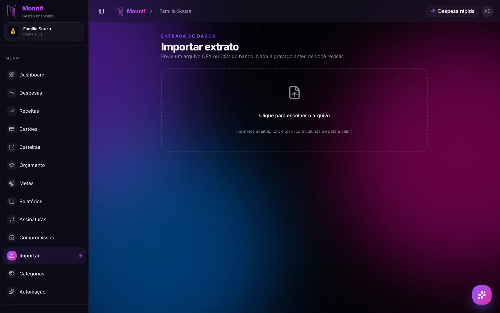

Dá para usar um **app de controle financeiro sem conectar o banco** — e, para a maior parte
das casas, ele controla melhor, não pior. A conexão automática resolve a parte do controle que
já era fácil: saber o que saiu da conta. A parte difícil, que é saber o que ainda vai sair e
decidir antes, o banco não conhece.

Isso não faz do Open Finance um vilão. Ele é regulado pelo Banco Central, a autorização é sua
e dá para desfazer quando quiser. A pergunta é outra: o que você ganha entregando o extrato a
mais uma empresa, e se isso vale o que custa. Este texto faz essa conta, diz quando conectar
compensa e mostra o método para quem prefere não conectar.

## Os dois jeitos de um app ler a sua conta

Eles têm pouco em comum além do resultado na tela.

**Open Finance.** É o caminho regulado. Você escolhe o banco dentro do app de finanças, é
levado para o app **do próprio banco**, confere o que vai ser compartilhado e autoriza ali.
Nenhuma senha sai do banco. O consentimento pode ser revogado a qualquer momento, tanto no app
do banco quanto no app que recebeu os dados.

**Usuário e senha.** O jeito antigo: você digita a senha do banco no app de finanças e um robô
entra na sua conta como se fosse você. Se um app pede isso, feche. A senha passa a morar num
terceiro, e qualquer problema com ela é seu — é a sexta das
[sete perguntas que eliminam quase todo app de gestão financeira](/blog/app-de-gestao-financeira/).

Daqui para frente, "conectar" quer dizer Open Finance. É o único dos dois que merece a
conversa.

## O que chega quando você conecta

Chega o extrato, linha por linha, a cada sincronização. Uma semana comum chega assim:

| O que o banco manda | O que aconteceu |
|---|---|
| PIX ENVIADO MARIA S | Metade da conta de luz, devolvida para a sua irmã |
| COMPRA 4432 PAG*JOSE | Feira do sábado |
| PIX ENVIADO MARIA S | Sua parte no presente da sobrinha |
| PIX ENVIADO J P SILVA | Aluguel |
| COMPRA 4432 PAG*LANCHONETE | Lanche que você pagou para o colega, que vai devolver |

O app recebe a primeira coluna. A segunda continua na sua cabeça — e é ela que o orçamento
precisa. Dois Pix iguais para a mesma pessoa foram parar em categorias diferentes da sua vida;
o app conectado vai pôr os dois na mesma, ou em nenhuma. Alguém ainda vai revisar linha por
linha. A diferença é que, com a conexão, essa revisão acontece no fim do mês, quando você já
não lembra o que foi o "PAG*JOSE".

## O que o banco não sabe

Quatro coisas ficam de fora de qualquer conexão, por mais bem-feita que ela seja:

1. **O que ainda vai sair.** O extrato é retrovisor. A conta de luz que vence dia 15, o boleto
   da escola, o IPVA de janeiro: nada disso aparece no extrato até o dia em que sai. E é isso que
   decide se o mês fecha. Com cartão é pior, porque a compra de hoje só pesa quando a fatura
   vence — o motivo está em [sua fatura não segue o mês do calendário](/blog/ciclo-da-fatura/).
2. **Por que você gastou.** A tabela de cima. Descrição de extrato é nome de recebedor, não
   motivo.
3. **Quem gastou.** Cartão adicional sai no extrato do titular. Conta conjunta é um extrato só
   para duas pessoas. Para um casal que quer saber quem pagou o quê, a conexão entrega
   exatamente a informação que falta — o problema inteiro está em
   [dividir as contas do casal](/blog/dividir-contas-do-casal/).
4. **O que não passa pelo banco.** Dinheiro vivo, a conta que a outra pessoa da casa não
   conectou, os R$ 600 que você emprestou ao seu irmão e que voltam em três vezes. Saldo
   somado de banco não é o seu dinheiro; a diferença está em
   [gestão de carteiras](/blog/gestao-de-carteiras/).

E um quinto ponto, que não é do banco mas pesa: **a conexão para sem fazer barulho.** Banco
que muda o sistema, autorização que venceu, cooperativa que o app não atende. O mês em que a
sincronização falha é o mês em que o controle some — e você descobre olhando um gráfico calmo
demais.

## Anotar não é o atraso, é o controle

O argumento a favor da conexão é sempre o mesmo: anotar dá trabalho, e ninguém anota. A
segunda parte é verdade. A primeira depende de onde você anota.

O momento de anotar é o momento em que você percebe o gasto. Quem conecta o banco tira o
atrito e, junto com ele, a atenção: o app sabe tudo o que você gastou, e você não. Quem anota
na hora sabe, no dia 12, que o mercado já foi a R$ 1.100 de um teto de R$ 1.500 — e muda a
compra do sábado. Isso é controle. Um gráfico bonito no dia 30 é só histórico.

A saída para o trabalho não é tirar você do circuito. É deixar o registro tão barato que ele
caiba na fila do caixa: uma frase, "almoço 38 no débito", mandada por mensagem. Por que isso
funciona onde o formulário do app falha está em
[anotar gasto pelo WhatsApp](/blog/anotar-gasto-pelo-whatsapp/).

## Conectar, importar ou anotar

Os três jeitos de o gasto entrar no app — conectar pelo Open Finance, importar o extrato ou
anotar na hora —, lado a lado:

| | Conectar | Importar | Anotar |
|---|---|---|---|
| Quem acessa a conta | O app e quem conecta por ele | Só você | Só você |
| Entra sozinho | O que passa pelas contas | O que está no arquivo | Só o que você anota |
| Escapa | Motivo, autor, espécie, o que vai vencer | Motivo, autor, espécie, o que vai vencer | O que você esquece |
| Você vê o gasto | Quando o app atualiza | Ao importar | Na hora |
| Trabalho do mês | Revisar a categoria de tudo | Um arquivo por conta, e revisar | Uma frase por gasto |

Faça a conta da última coluna. Uma casa com cinco gastos por dia tem 150 lançamentos no mês. A
cinco segundos cada, são **12 minutos e meio por mês** — menos tempo do que revisar 150 linhas
de "PIX ENVIADO" no dia 30.

A combinação que cobre quase tudo é a das duas colunas da direita: anotar na hora e importar o
extrato uma vez por mês para conferir. O extrato pega o que você esqueceu; a anotação pega o
motivo, o autor e o que ainda vai vencer. Nenhuma das duas entrega acesso à sua conta a
ninguém.

## Quando conectar compensa

Tem casos em que a conexão é a escolha certa, e vale dizer quais:

- **Muitas contas e muito volume.** Quatro bancos, três cartões, dezenas de transações por dia
  — o caso típico de quem mistura conta pessoal com a da empresa sem separar.
- **Você só quer o retrovisor.** Saber para onde o dinheiro foi no ano, sem a pretensão de
  planejar o mês que vem.
- **Você sabe que não vai anotar nem importar.** Conectado é melhor do que nada, e nada é o que
  sobra de quase todo controle que depende de uma disciplina que você não tem.

Na maior parte dos apps grandes, a sincronização bancária é recurso do plano pago. Entre na
conta sabendo disso: você vai pagar para entregar o extrato, e ainda revisar as categorias.

## Se for conectar, cinco cuidados

1. **A autorização acontece no app do seu banco.** Nunca por link recebido em SMS, e-mail ou
   WhatsApp. Tela de "autorizar compartilhamento" fora do app oficial do banco é golpe.
2. **Ninguém pede senha, token ou código por mensagem ou telefone.** Nem o banco, nem o app de
   finanças, nem "a central do Open Finance".
3. **Leia o nome na tela de autorização.** É quem vai receber os seus dados — e pode não ser o
   nome do app que você baixou, e sim o da empresa que faz a conexão para ele.
4. **Autorize só o que o controle precisa.** Conta e cartão bastam. Se o app deixar escolher,
   empréstimos e investimentos ficam de fora.
5. **Saiba onde desfazer.** No app do banco, procure "Open Finance" ou "compartilhamento de
   dados". Ali aparece quem tem acesso às suas contas e o botão de encerrar.

## O método sem conexão

Para quem prefere não conectar, cinco hábitos dão o controle que a conexão prometia — e o que
ela não entrega:

1. **Comece pelos últimos três meses de extrato.** Baixe o arquivo OFX no site do banco e
   importe. É o retrato que a conexão daria, sem acesso permanente a nada. O passo a passo está
   em [três meses de histórico em cinco minutos](/blog/importar-extrato-sem-digitar/).
2. **Anote no momento, numa frase.** Por mensagem, por áudio, do jeito que você contaria para
   alguém. Se for usar um bot de WhatsApp para isso, as perguntas antes de escolher estão em
   [controle financeiro pelo WhatsApp](/blog/controle-financeiro-pelo-whatsapp/).
3. **No cartão, lance a compra, não a fatura.** A compra entra no dia em que aconteceu e cai na
   fatura do ciclo dela. Compra parcelada vira uma parcela em cada mês que ela ocupa — e é aí
   que se enxerga [quanto do mês que vem já está gasto](/blog/em-10x-sem-juros/).
4. **O que vai vencer entra antes de vencer.** Contas fixas com repetição, parcelas, e os
   anuais divididos por doze, como no passo 4 do
   [orçamento familiar](/blog/orcamento-familiar/).
5. **Confira uma vez por mês.** Importe o extrato do mês que fechou: o que você anotou bate, o
   que você esqueceu aparece sobrando. Dez minutos, uma vez por mês.

## Perguntas que aparecem antes de escolher

### Open Finance é seguro?

O sistema é regulado pelo Banco Central, o compartilhamento depende de uma autorização sua
dada dentro do app do banco, e pode ser revogado a qualquer momento. O risco maior não está no
sistema: está no golpe que usa o nome dele — link falso, tela falsa de autorização — e em
quanto você confia na empresa que passa a receber o seu extrato.

### App de controle financeiro pode pedir a senha do banco?

Não deveria. No Open Finance a senha nunca sai do app do banco. App que pede usuário e senha
bancária está usando o jeito antigo, e você assume o risco de ter a credencial guardada por
outra empresa.

### Sem conectar, o app fica desatualizado?

Fica tão atualizado quanto o seu último lançamento. Quem anota na hora tem o app em dia antes
de o banco sincronizar qualquer coisa — e, diferente do conectado, com o que ainda vai vencer
já lá dentro.

### Dá para importar o extrato de qualquer banco?

Quase todo banco brasileiro oferece o extrato em OFX ou CSV, na área de extrato, em
"exportar" ou "baixar". OFX é o melhor: já vem com data, valor e descrição bem definidos. CSV
funciona desde que tenha colunas de data e valor.

## Como isso fica no Monnif

O Monnif é um app de controle financeiro que não se conecta ao banco — e isso é escolha, não
pendência.

**Ninguém pede a sua senha bancária, e não existe Open Finance.** O Monnif não tem acesso a
conta nenhuma sua: o que entra lá é o que você anota ou o arquivo que você mesmo baixou. Como
os dados são guardados está em [segurança](/seguranca/). E se o que você quer é não anotar
nada, a [comparação entre planilha, apps e o Monnif](/comparar/) diz com franqueza onde um app
com conexão resolve melhor.

**O histórico entra pelo extrato.** [Importar](/docs/dados/importar/) aceita OFX e CSV, mostra
uma prévia antes de gravar qualquer coisa, reconhece o que você já tinha lançado como previsto
e desfaz a importação inteira com um botão. A importação é um recurso extra, opcional.

**O dia a dia entra por mensagem, de graça.** O
[assistente no WhatsApp](/recursos/whatsapp/) lança o gasto a partir de uma frase ou de um
áudio, e ele aparece na conta na hora. Como recurso extra, opcional, a foto do cupom fiscal
também vira lançamento, sempre com confirmação antes de gravar.

**O que vai vencer já está na tela.** Contas fixas e parcelas entram como
[despesas com repetição](/docs/dia-a-dia/despesas/), cada [cartão](/docs/dia-a-dia/cartoes/)
tem dia de fechamento e de vencimento, e a aba **Fluxo** do
[dashboard](/docs/dia-a-dia/dashboard/) desenha o saldo dia a dia e marca a data em que a conta
cruza o zero — com semanas de antecedência, coisa que extrato nenhum mostra.

**O que o banco não vê ganha lugar.** Dinheiro vivo e a conta da empresa viram
[carteiras](/docs/dia-a-dia/carteiras/) separadas, e numa conta compartilhada o
[histórico](/docs/dados/historico/) guarda quem lançou o quê.

## O exercício de hoje

Abra o app do seu banco e procure "Open Finance" ou "compartilhamento de dados". Veja quem já
tem acesso às suas contas hoje — e encerre o que você não reconhece ou não usa mais.

Depois, na área de extrato do mesmo app, baixe o arquivo do mês passado. É o retrato inteiro
do seu mês, e ninguém além de você precisou entrar na sua conta para tirá-lo.
