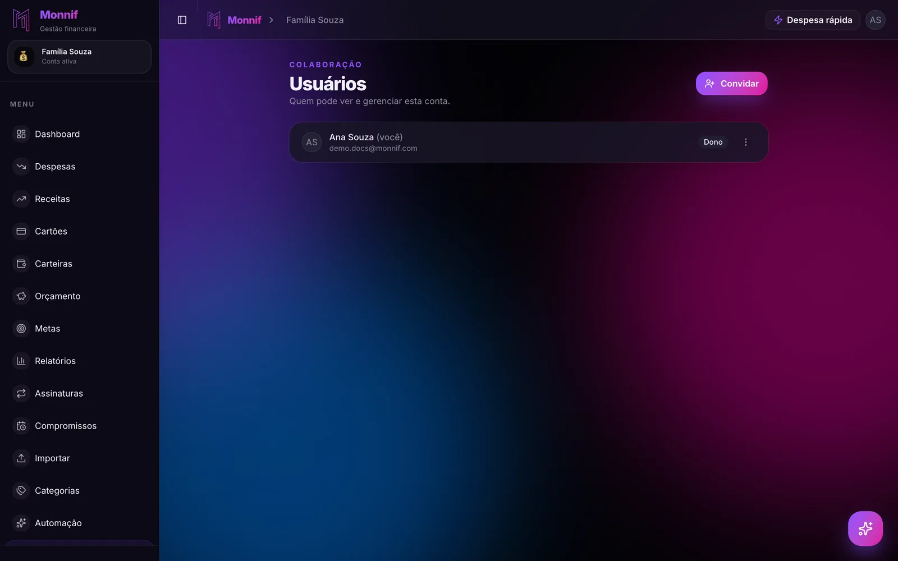

**Dividir as contas do casal** parece uma decisão de regra — meio a meio ou proporcional à
renda — e por isso a conversa costuma parar nela. A regra é a parte fácil. O que derruba o
combinado é a contabilidade: quem pagou o mercado da terça, se a farmácia era da casa ou
pessoal, quanto do aluguel já foi acertado.

Este texto é sobre essa contabilidade: o que entra no acerto, a conta feita com números e o
que procurar num app de gestão financeira para casal que faça isso por vocês. Qual regra
escolher — tudo junto, separado com rateio ou proporcional — está em
[dinheiro a dois](/blog/dinheiro-a-dois/).

## Primeiro: o que é da casa

O acerto só funciona com fronteira. Sem ela, todo fim de mês vira a mesma discussão sobre o
mesmo xampu.

| Da casa | Pessoal |
|---|---|
| Aluguel, condomínio, IPTU | Roupa, academia, cabelo |
| Luz, água, gás, internet | O almoço do trabalho |
| Mercado, limpeza, farmácia de uso comum | Presente para a própria família |
| Delivery quando os dois comem | Assinatura que só um usa |

A regra prática cabe numa linha: **se os dois usam, é da casa; se só um usa, é pessoal** —
mesmo que tenha passado no mesmo caixa do mercado. O que ficar no meio, decidam uma vez e
escrevam. Decidir de novo todo mês é o que cansa.

O pessoal nunca entra no acerto, e não precisa ficar visível para o outro. Por que essa
separação é o que mantém os dois usando o mesmo app está em
[gestão financeira para casais](/blog/gestao-financeira-para-casais/).

## A conta, com números

Ana ganha R$ 6.000 e Bruno, R$ 4.000. No mês, as despesas da casa foram estas:

| Despesa | Valor | Quem pagou |
|---|---|---|
| Aluguel | R$ 2.400 | Ana |
| Condomínio | R$ 600 | Ana |
| Farmácia | R$ 160 | Ana |
| Mercado (três compras) | R$ 1.300 | Bruno |
| Luz | R$ 220 | Bruno |
| Internet | R$ 120 | Bruno |
| Delivery | R$ 200 | Bruno |
| **Total** | **R$ 5.000** | |

**Passo 1: quanto cada um pagou.** Ana, R$ 3.160. Bruno, R$ 1.840.

**Passo 2: quanto cada um deveria ter pago.** Depende da regra. No meio a meio, R$ 2.500 cada.
No proporcional, a renda do casal é R$ 10.000, Ana entra com 60% dela e Bruno com 40% — então
R$ 3.000 e R$ 2.000.

**Passo 3: a diferença.**

| | Pagou | Devia (meio a meio) | Saldo | Devia (proporcional) | Saldo |
|---|---|---|---|---|---|
| Ana | R$ 3.160 | R$ 2.500 | + R$ 660 | R$ 3.000 | + R$ 160 |
| Bruno | R$ 1.840 | R$ 2.500 | − R$ 660 | R$ 2.000 | − R$ 160 |

No meio a meio, Bruno transfere R$ 660 para Ana. No proporcional, R$ 160.

A diferença de R$ 500 é a regra falando. No meio a meio, a casa come 62,5% da renda de Bruno e
41,7% da de Ana. No proporcional, come 50% da renda de cada um. Nenhuma das duas está errada —
mas os dois precisam saber qual escolheram, e o que ela significa em reais.

## Uma transferência por mês, não sete Pix

O jeito intuitivo é reembolsar despesa por despesa: Bruno pagou o mercado, Ana manda a
metade; Ana pagou o aluguel, Bruno manda a parte dele. No mês do exemplo, isso dá sete Pix
— e cada um é uma chance de esquecer, arredondar ou mandar duas vezes.

O jeito que dura é somar tudo e acertar a **diferença**, uma vez, numa data fixa. Uma
transferência de R$ 160 no dia 5 substitui sete idas e vindas ao longo do mês. A data boa é a
da conversa mensal de trinta minutos que está em [dinheiro a dois](/blog/dinheiro-a-dois/):
quem já vai olhar o mês junto acerta na mesma hora.

## Os quatro casos que bagunçam o acerto

### A compra no cartão de um, para a casa

Bruno faz o mercado no cartão dele. Conte essa compra no mês da fatura em que ela cai, que é
quando o dinheiro sai de verdade do bolso dele. Contar no dia da compra faz o acerto de
setembro pagar o que só vai sair em outubro. Por que a fatura desalinha o mês está em
[sua fatura não segue o mês do calendário](/blog/ciclo-da-fatura/).

### O parcelado

Uma geladeira de R$ 3.000 em 10x entra no acerto como R$ 300 por mês, enquanto a parcela
durar — não R$ 3.000 no mês da compra. Do contrário, um dos dois banca a geladeira inteira
num mês e recebe de volta nos nove seguintes, sem que ninguém tenha combinado esse
empréstimo. O que o parcelado faz com os meses que ainda não chegaram está em
[em 10x sem juros](/blog/em-10x-sem-juros/).

### A compra mista

Mercado de R$ 420, com R$ 60 de coisa só de Ana. Separe na hora: R$ 360 da casa, R$ 60
pessoal. Se não separar, o acerto absorve os R$ 60 — e absorve de novo no mês seguinte, e no
outro, sempre a favor de quem faz o mercado.

### O Pix que já foi feito no meio do mês

Bruno mandou R$ 300 para Ana no dia 15, "pela luz". Isso entra no acerto como pagamento dele.
No proporcional do exemplo, Bruno devia R$ 160 e já mandou R$ 300: no fim do mês, quem
transfere é Ana, R$ 140. Esquecer o Pix do meio do mês é o jeito mais comum de alguém pagar
duas vezes.

## O que procurar num app de gestão financeira para casal

Planilha faz essa conta, até quem cuida dela cansar. Num app, o que importa para o acerto:

- **Cada um com o próprio login**, na mesma conta da casa. Senha compartilhada acaba com o
  registro de quem fez o quê.
- **Registro de quem pagou**, não só de quem lançou: de que carteira ou cartão o dinheiro saiu.
- **Conta pessoal separada**, que o outro não enxerga.
- **Dividir um lançamento** entre os dois — para a compra mista e para a regra proporcional.
- **Acerto no menor número de transferências**, calculado pelo app.
- **Os dois lançando do próprio celular**, de preferência pelo WhatsApp, no momento do gasto. O
  que checar num bot antes de vincular o número está em
  [controle financeiro pelo WhatsApp](/blog/controle-financeiro-pelo-whatsapp/).

Se a única coisa que vocês querem é rachar a conta da viagem, um app de dividir despesas
resolve com menos passos — ele registra quem deve e para aí, sem fatura nem orçamento. A
comparação entre planilha, apps e o Monnif pelos critérios de casal está em
[controle financeiro para casal: qual usar](/comparar/casal/).

## Como isso fica no Monnif

**A conta da casa tem as duas pessoas, cada uma com o próprio acesso.** No plano grátis cabem
duas contas, com até duas pessoas em cada: a da casa, com os dois, e a sua pessoal, que o outro
não vê. O convite é por link, e os papéis estão em [pessoas e papéis](/docs/conta/usuarios/).

**Cada despesa diz de onde o dinheiro saiu.** Carteira ou cartão é campo do
[lançamento](/docs/dia-a-dia/despesas/), e o [histórico](/docs/dados/historico/) guarda quem
lançou. Uma [carteira](/docs/dia-a-dia/carteiras/) e um cartão para cada um — no grátis cabem
dois de cada — já respondem "quem pagou" em cada linha.

**O acerto automático é do plano Super.** Nele, um lançamento é rachado entre as pessoas da
conta, e o app mostra quem pagou quanto e quem deve a quem, no menor número de
transferências. No grátis e no Plus, a conta da casa é um bolo só — o que serve a quem
escolheu o arranjo tudo junto, e a quem prefere fazer a conta da tabela acima uma vez por mês.
Os planos estão em [preços](/precos/), e o resto do que o Monnif faz para quem divide a casa,
em [Monnif para casais](/para/casal/).

**Os dois lançam pelo WhatsApp.** Cada um [vincula o próprio número](/docs/assistente/whatsapp/)
à conta da casa, e o que um manda aparece para o outro na hora, com o nome de quem mandou.

## A conta do mês passado

Pegue o mês passado. Numa coluna, as despesas da casa; na outra, quem pagou. Faça a conta duas
vezes: meio a meio e proporcional à renda.

Se os dois números ficarem perto, a regra que vocês usam hoje serve. Se ficarem longe, como os
R$ 660 e os R$ 160 do exemplo, vocês acabaram de encontrar a pauta da próxima conversa.
