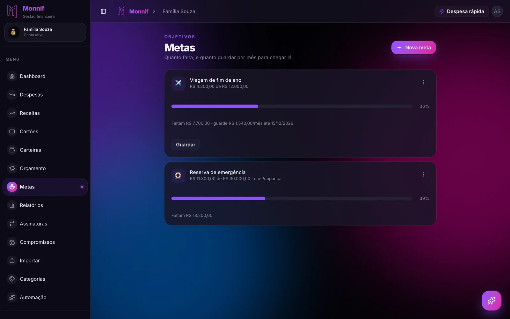
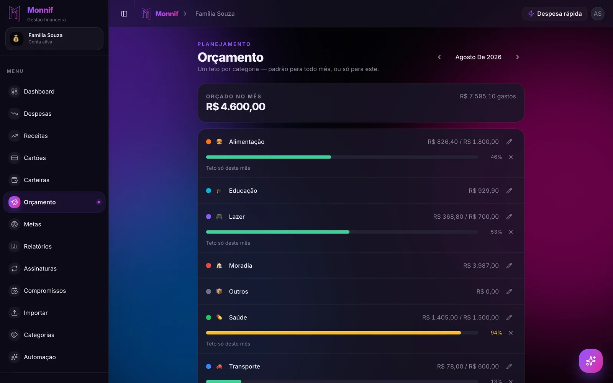

Quem pergunta **o que fazer com o 13º salário** quase sempre pergunta tarde: em dezembro, com
o dinheiro na conta e a lista de presentes na mão. Nessa hora a resposta já foi dada pelo
próprio dezembro — a ceia, o amigo secreto, a viagem que "dá para fazer porque tem o 13º".
Em janeiro chegam o IPVA, o IPTU, a matrícula e a fatura do Natal, e o salário extra de um
mês atrás não está mais em lugar nenhum.

O 13º é o único dinheiro do ano que chega com data marcada e valor conhecido. Isso faz dele
o mais fácil de planejar e o mais fácil de perder, porque ele parece sobra. Não é: na maioria
das casas, ele já tem dono antes de cair. O trabalho é descobrir quem é, e decidir isso em
novembro.

## Quando cai, e por que a segunda parcela é menor

Para quem é CLT, o 13º vem em duas parcelas:

- **A primeira, até 30 de novembro.** É metade do salário bruto, sem desconto nenhum.
- **A segunda, até 20 de dezembro.** Em 2026 o dia 20 cai num domingo, então ela tem que sair
  até sexta, dia 18. É a outra metade **menos o INSS e o Imposto de Renda do 13º inteiro** —
  os descontos das duas parcelas saem todos dela.

Por isso a segunda parcela é sempre menor que a primeira, e quem conta com duas metades
iguais erra justamente a que chega mais perto do Natal. O número que vale é o líquido das
duas somadas. A primeira aparece no holerite de novembro; para a segunda, uma estimativa
conservadora é melhor que uma otimista.

Quem entrou no emprego durante o ano recebe proporcional: um doze avos do salário por mês
trabalhado, contando como mês inteiro aquele em que trabalhou 15 dias ou mais.

## Janeiro já mandou a conta

Antes de decidir qualquer coisa, liste o que chega entre janeiro e fevereiro. Uma casa com
carro e um filho na escola, com os valores do ano passado:

| Conta do começo do ano | Valor |
|---|---|
| IPVA | R$ 1.200 |
| IPTU | R$ 650 |
| Matrícula e material escolar | R$ 950 |
| **Total** | **R$ 2.800** |

Nada disso é imprevisto. Tem data marcada, valor conhecido e acontece todo ano — e mesmo
assim é a linha que quase todo orçamento esquece, como mostra o passo 4 de
[orçamento familiar](/blog/orcamento-familiar/). O 13º existe, na prática, para pagar essa
tabela. Quem não usa ele para isso paga janeiro do único jeito que sobra: no cartão,
parcelado em fevereiro, março e abril.

## Primeiro: a dívida que cobra juros

Se existe saldo no rotativo do cartão ou no cheque especial, ele sai antes de tudo. O
cheque especial tem teto de 8% ao mês; o rotativo cobra na casa dos 400% ao ano. Nenhum
outro destino do 13º rende perto disso, e cada mês que essa dívida roda come uma fatia do
próximo 13º.

A única ressalva é não zerar a conta para pagar a dívida e ficar sem nada: com um mês de
despesas guardado, o primeiro imprevisto não volta direto para o cartão. A ordem de ataque
quando há mais de uma dívida está em
[bola de neve ou avalanche: por onde sair das dívidas](/blog/sair-das-dividas/).

## Segundo: as contas que têm data

Depois da dívida cara, a tabela de janeiro. O dinheiro dela sai da conta corrente no dia em
que o 13º cai e vai para um lugar separado, onde não seja gasto por engano em dezembro.

Pagar à vista costuma valer a pena: vários estados dão desconto no IPVA em cota única, e as
prefeituras costumam fazer o mesmo com o IPTU. É um desconto garantido, em semanas, sobre um
dinheiro que você já tinha.

## Terceiro: a reserva

Quem não tem reserva de emergência — ou tem menos do que precisa — põe ali o que sobrou das
duas primeiras. O 13º é a melhor chance do ano de dar um salto nela sem apertar nenhum mês,
porque é dinheiro que não entra no orçamento mensal. Quanto guardar e onde deixar está em
[reserva de emergência: quanto, onde e a partir de quando](/blog/fundo-de-emergencia/).

## Quarto: o resto, sem culpa

O que sobrar depois das três primeiras é seu de verdade. Presente, ceia, viagem, a troca do
celular — sem culpa nenhuma, porque janeiro já está pago.

Com um 13º líquido de R$ 4.800, R$ 800 no cheque especial e a tabela de janeiro acima:

| Destino | Valor |
|---|---|
| 1. Zerar o cheque especial | R$ 800 |
| 2. IPVA, IPTU e escola | R$ 2.800 |
| 3. Reserva de emergência | R$ 600 |
| 4. Livre: presentes, ceia, o que a casa quiser | R$ 600 |
| **Total** | **R$ 4.800** |

R$ 600 de livre parece pouco. É exatamente o tamanho do Natal que essa casa pode pagar sem
pedir emprestado ao próprio janeiro. A mesma ideia, em versão anual, está em
[a regra 50/30/20 não cabe no salário brasileiro](/blog/regra-50-30-20/): o dinheiro extra do
ano paga as contas anuais do ano.

## Natal no cartão é janeiro de novo

O furo mais comum do plano está na quarta linha. Os R$ 600 de livre ficam guardados, e os
presentes vão para o cartão — "depois eu pago com o 13º". Só que, dependendo do dia de
fechamento, a compra de dezembro vence em janeiro, na mesma semana do IPVA. O mecanismo
inteiro está em [sua fatura não segue o mês do calendário](/blog/ciclo-da-fatura/).

Duas saídas, as duas simples: pagar os presentes no débito ou no Pix com o dinheiro da linha
livre, ou deixar esse dinheiro separado até a fatura vencer. O que não funciona é parcelar o
Natal em cinco vezes — aí ele dura até maio, e o 13º do ano que vem já nasce comprometido.
A Black Friday cai bem no meio desse caminho, e
[o que decidir antes dela](/blog/black-friday-sem-divida/) é o mesmo raciocínio.

## Antecipar parcela ou guardar?

Quem tem financiamento ou empréstimo pergunta se vale usar o 13º para adiantar parcelas.
Depende do tipo:

- **Parcela com juros** — financiamento de carro, empréstimo pessoal, consignado. O Código
  de Defesa do Consumidor garante a redução proporcional dos juros quando você antecipa, e
  as últimas parcelas são as que mais encolhem. Vale a pena, **depois** da reserva: quem
  antecipa financiamento sem ter colchão troca uma dívida barata por uma cara no primeiro
  imprevisto.
- **Parcela sem juros** — a compra em 10x da loja. Antecipar não abate nada; só troca o dia
  em que o dinheiro sai. Melhor deixar o valor guardado e pagar na data. O porquê está em
  [em 10x sem juros: o mês que vem já está gasto](/blog/em-10x-sem-juros/).

## Decida antes de cair

Nada do que está acima exige disciplina em dezembro, desde que a decisão seja tomada em
novembro. Dinheiro que cai na conta corrente sem destino vira gasto do dia, e não por
fraqueza: a conta corrente é o lugar de onde o dinheiro sai, e ele sai.

O método tem três passos:

1. **Lance as duas parcelas como receita prevista**, com a segunda estimada por baixo.
2. **Lance as contas de janeiro com a data em que vencem.** Elas deixam de ser surpresa e
   viram linha.
3. **No dia em que cada parcela cair, transfira na hora** a parte das linhas 2 e 3 para
   uma conta separada. Antes do almoço, antes de abrir qualquer loja.

## Sem 13º: autônomo, MEI e PJ

Quem trabalha por conta não recebe 13º, mas recebe o janeiro igual — o IPVA não pergunta o
regime de contratação. A solução é a mesma tabela, só que construída aos poucos: o valor de
janeiro dividido por doze, guardado todo mês. A conta inteira, com o 13º e as férias de quem
não tem nenhum dos dois, está em
[quando a renda muda todo mês, a média mente](/blog/renda-que-muda-todo-mes/).

## Como isso fica no Monnif

**As duas parcelas entram como receita prevista.** Em [Receitas](/docs/dia-a-dia/receitas/),
lance a primeira para 30 de novembro e a segunda para 18 de dezembro, com o valor
conservador. Elas passam a contar na sobra prevista do mês antes de cair, e o círculo marca o
recebido quando o dinheiro chegar. Pelo WhatsApp, "caiu a primeira parcela do 13º, 2.750"
faz o mesmo.

**As contas de janeiro já estão lá.** IPVA, IPTU e matrícula entram como
[despesa com repetição anual](/docs/dia-a-dia/despesas/), e navegar até janeiro com as setas
do mês mostra o que já está previsto. A aba **Fluxo** do
[dashboard](/docs/dia-a-dia/dashboard/) desenha o saldo dia a dia e mostra se a conta cruza o
zero em janeiro — com semanas de antecedência, e não no dia do boleto. O aviso de
[contas a vencer](/docs/conta/preferencias/) chega três dias antes de cada uma.

**O dinheiro de janeiro mora numa carteira própria.** Crie uma
[carteira](/docs/dia-a-dia/carteiras/) "Janeiro" e transfira para ela no dia em que o 13º
cair. A transferência não é despesa nem receita, então a sobra do mês continua honesta. Ligue
a ela uma [meta](/docs/planejamento/metas/) de R$ 2.800 com data em janeiro: o progresso é o
próprio saldo da carteira, sem aporte manual. De graça, são duas carteiras, a Principal e
mais uma; se a reserva também precisar da dela, mais carteiras são um recurso extra,
opcional.

**Dezembro tem teto próprio.** No [orçamento](/docs/planejamento/orcamento/), um teto só deste
mês na categoria de presentes, com o valor da linha livre, vale para dezembro sem mexer no
resto do ano. Compra no cartão conta na categoria dela, então o teto enxerga o presente que
foi no crédito — e o aviso chega quando a categoria passa de 80%.

## O exercício de antes de 30 de novembro

Pegue um papel e escreva quatro números:

1. Quanto do 13º vai cair, líquido — com a segunda parcela estimada por baixo.
2. Quanto você deve hoje no rotativo e no cheque especial.
3. Quanto chega em janeiro e fevereiro, com os valores do ano passado.
4. Quanto falta para ter um mês de despesas guardado.

Subtraia o segundo, o terceiro e o quarto do primeiro. Se sobrou, é seu, e pode ir para a
ceia. Se não sobrou, o 13º ainda fez o trabalho mais importante dele: impediu que janeiro
virasse a dívida de março.
